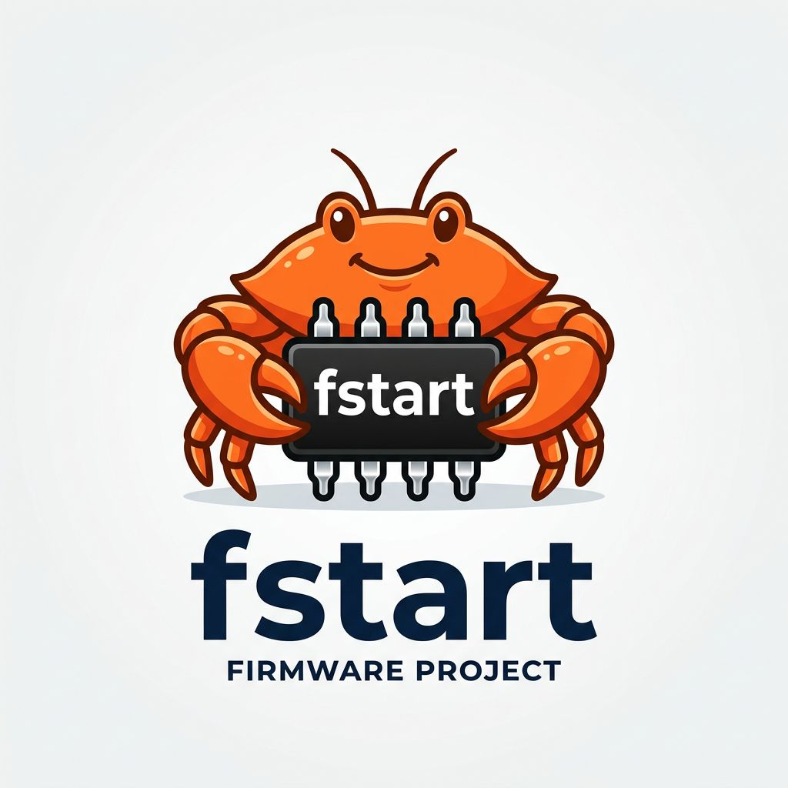

<p align="center">
  
</p>

# fstart

A firmware framework in Rust using Rust board crates with builder-pattern board
metadata, fixed handwritten stage flow, and step-based hardware initialization.

Supports RISC-V 64, AArch64, and ARMv7. Boots Linux. Runs on QEMU and real
hardware (Allwinner A20).

**Experimental.** This is early-stage software. Internals, APIs, and the board
file format may change drastically without notice.

## Quick start

```bash
# Run a pre-defined board in QEMU
cargo fbuild run --board qemu-riscv64
cargo fbuild run --board qemu-aarch64

# Build without running
cargo fbuild build --board qemu-riscv64

# Build a signed firmware image (FFS). Without --signing-key the image is
# signed with a throwaway key; see docs/authenticated-boot.md.
openssl genpkey -algorithm ed25519 -out signing.pem
cargo fbuild assemble --board qemu-riscv64 --signing-key signing.pem
```

## Documentation

- **[Pineview boards](docs/pineview-boards.md)** — build selections, driver policy and hardware-validation limits.
